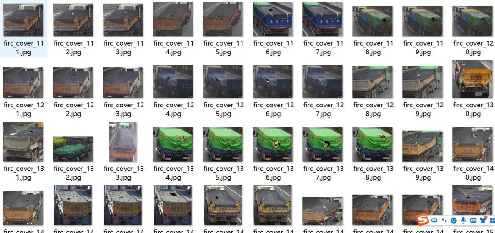
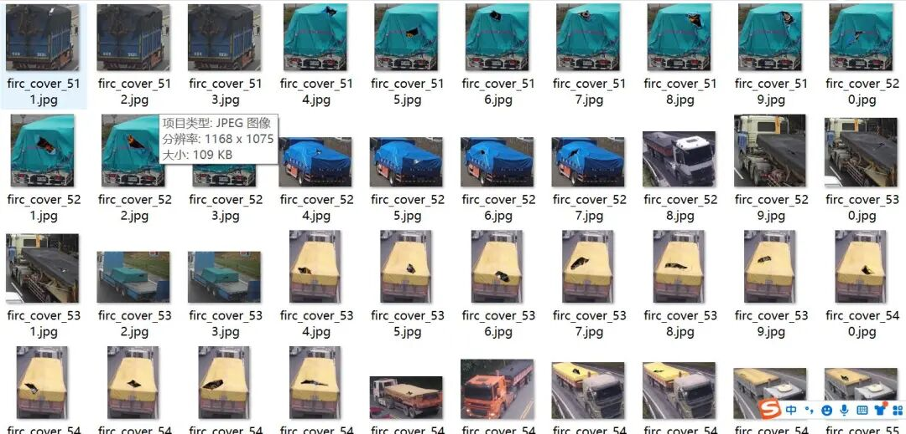
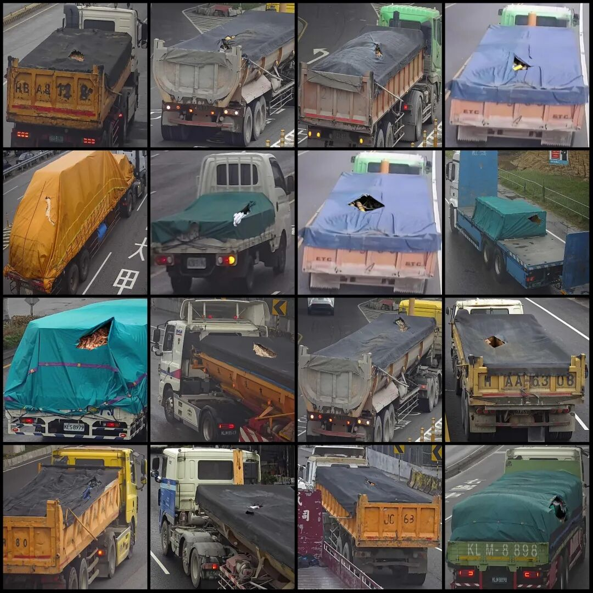
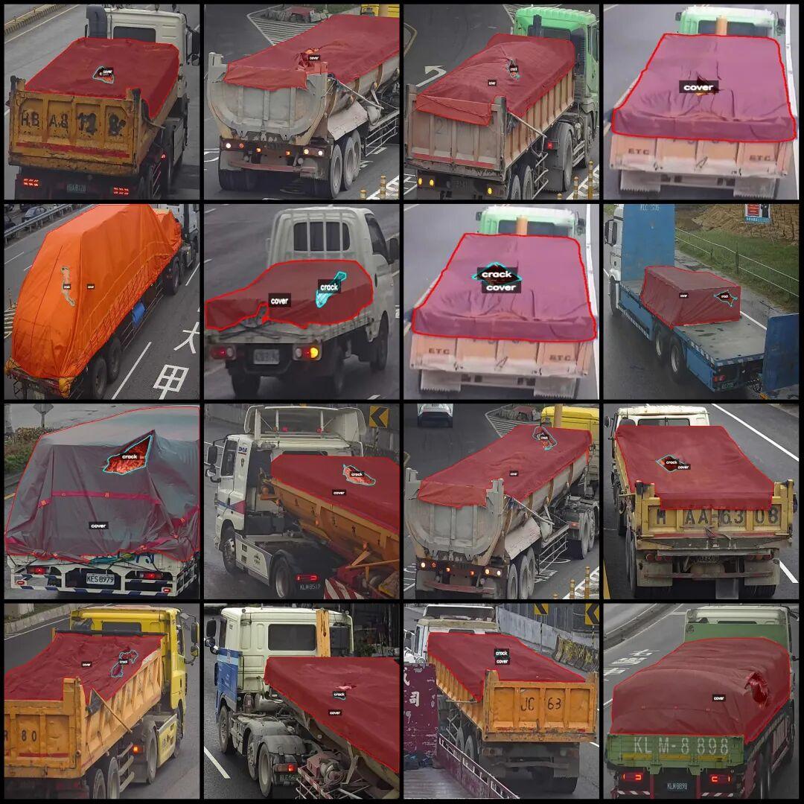
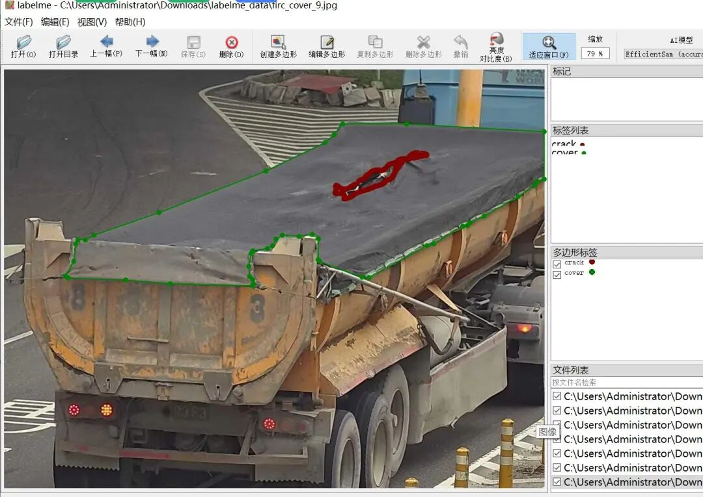

# Intelligent Transportation Trucks, Vans, and Vehicle Waterproof Covers, Ponchos, and Raincoats Damage Identification and Segmentation Dataset - LabelMe format: 1894 categories

Dataset format: labelme format (without mask files, only including jpg images and corresponding json files)

Number of images (number of jpg files): 1894

Number of annotations (json file count): 1894

Labeling category count: 2

Label category names: ["crack", "cover"]

Number of boxes labeled in each category:

Crack (Vehicle Fabric Damage) Count = 1830

Cover (car fabric) count = 1898

Total frame count: 3728

Using labeling tool: labelme=5.5.0

Image resolution: Multi-resolution images, such as 641x527, 719x683, etc.

Annotation rules: Draw polygons around the categories.

Important Notice: The dataset can be opened and edited using LabelMe. For JSON datasets, one must convert them into mask or Yolo formats for semantic segmentation or instance segmentation.

Special : This dataset does not guarantee the accuracy of the trained models or weight files.

Image Preview:

Annotation example:

Original image (randomly select 16 images):

Annotation:

LabelMe editing example:

## Payment

Here is a pay link on Stripe ( https://buy.stripe.com/3cs8yP7sY87d0vu9AB ). Please contact me lonlonago@foxmail.com after funding $89, and I will send you a complete data files , thank you!

